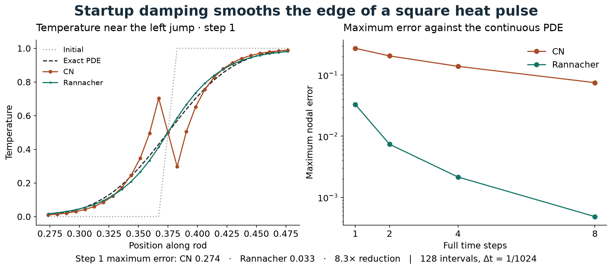
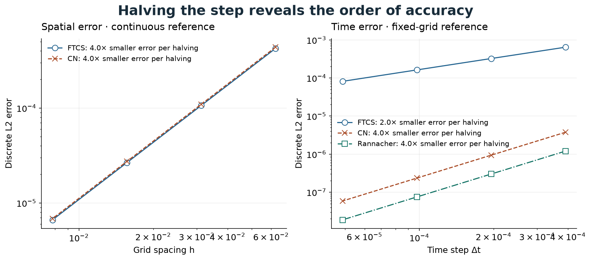
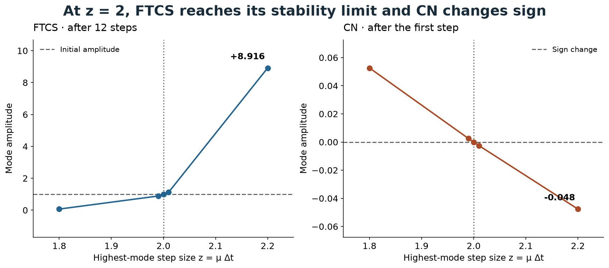
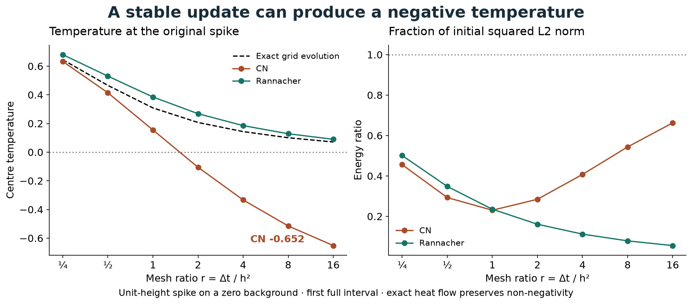
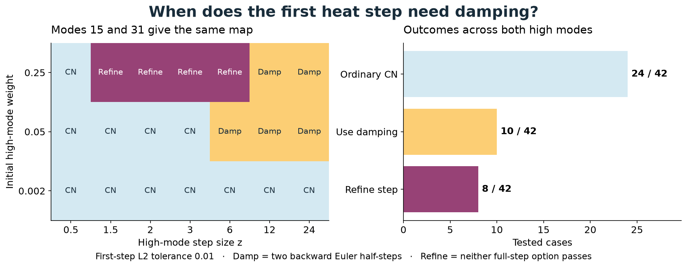
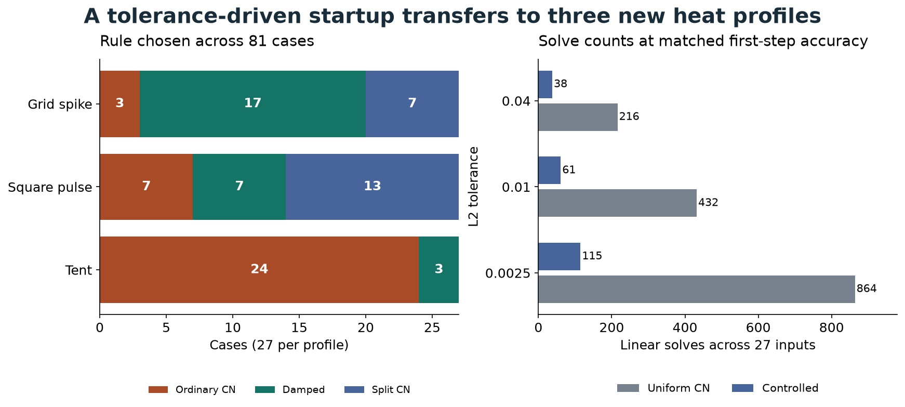
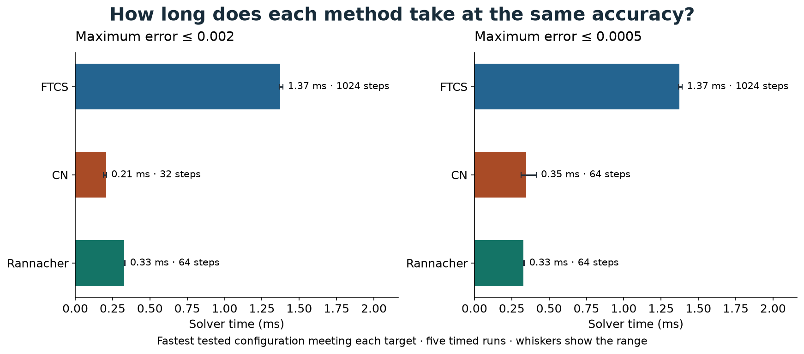

# 实验结果与展示顺序

## 1 · 同一个热斑，为什么会算出不同的边缘？

看左图温度跳变处。精确热流把边缘抹平，普通 CN 在最初的陡边两侧出现折返。右图比较相同物理时间的全网格最大误差。第一步阻尼启动将误差从 **0.2736** 降至 **0.0330**，相差 **8.3 倍**。参考值来自连续热方程的正弦级数；CSV 另列空间误差和纯时间误差。[误差与总变差](pulse_errors.csv) · [温度数据](pulse_profiles.csv)

## 2 · 先检查求解器，再解释振荡

在同一网格精确演化的参照下，时间观测阶分别为 FTCS **0.997**、CN **2.000**、阻尼启动后接 CN **2.000**。空间收敛单独检验；图例给出步长减半带来的误差缩减倍数。[全部网格与观测阶](convergence.csv)

虚线标出最高频模态的时间步参数 z = 2。左图看 FTCS 的振幅超过初值，右图看 CN 第一步从正变负。两图纵轴和观测步数各自标明。[稳定性原始数据](stability.csv)

## 3 · 稳定的数值解能给出多大的物理偏差？

初始温度处处非负。取 r = 16，普通 CN 第一步把中心从 1 算到 **-0.652**，精确网格演化给出 **+0.071**。此时 CN 的平方范数仍降至初值的 **66.2%**。这个反例区分了能量稳定与非负性。[能量与极值](positivity.csv)

## 4 · 什么时候值得加启动阻尼？

每格对应一次给定权重和步长的实验，显示满足首步时间误差容限 0.01 的选择。42 格中，普通 CN 在 24 格已达标，10 格需要阻尼，另有 8 格两种全步方案都超标。颜色和文字同时表示决策。[逐项误差](startup.csv) · [高频衰减动画](startup.gif)

把双模态判据推广到实测网格温度的完整离散正弦谱。三个新初值、三种网格和三种步长组成 27 个输入，每个输入测试三档容限。首步 **81/81** 次达到目标。用独立的矩阵指数作用检验，预测误差与实测误差的最大绝对差为 **7.67e-16**。尖峰只占一个网格点，改变网格会改变其物理宽度。该判据控制首步的离散时间误差；最终时刻和连续 PDE 的误差应另外检验。[每个输入的预测、独立验证和终点误差](transfer.csv)

## 5 · 计算量下降，实际用时怎样？

**控制器成本。** 下表中的每对数字依次为统一细分 CN 和按谱选择的启动。两者必须让同一组 27 个输入全部达标。统一策略使用事后验证过的最小合格二次幂细分数；表中省略了它的搜索成本。控制策略的计时包括选法、矩阵分解和求解。每个输入都单独初始化。小网格上的变换、筛选和初始化开销会影响实际用时。

| 首步容限 | 线性求解次数（统一 / 控制） | 五次计时中位数 ms（统一 / 控制） | 控制策略最坏误差 |
|---:|---:|---:|---:|
| 0.0025 | 864 / 115 | 5.58 / 3.03 | 0.002422 |
| 0.01 | 432 / 61 | 3.68 / 2.62 | 0.009883 |
| 0.04 | 216 / 38 | 2.72 / 2.45 | 0.03905 |

[完整成本、计时范围与全部重复值](controller_cost.csv)

**基础方法成本。** 固定同一网格和五个观测时刻，用相同连续 PDE 误差目标筛选。横线表示五次计时范围，条形末尾标明用时和步数。

| 最大误差目标 | 方法 | 步数 | 实测最大误差 | 中位用时 ms |
|---:|---|---:|---:|---:|
| 0.002 | FTCS | 1024 | 0.000127 | 1.37 |
| 0.0005 | FTCS | 1024 | 0.000127 | 1.37 |
| 0.002 | CN | 32 | 0.00119 | 0.21 |
| 0.0005 | CN | 64 | 0.000476 | 0.35 |
| 0.002 | Rannacher | 64 | 0.000146 | 0.33 |
| 0.0005 | Rannacher | 64 | 0.000146 | 0.33 |

[所有候选配置](cost_trials.csv) · [各方法达标配置](matched_cost.csv) · [运行环境](environment.json)
